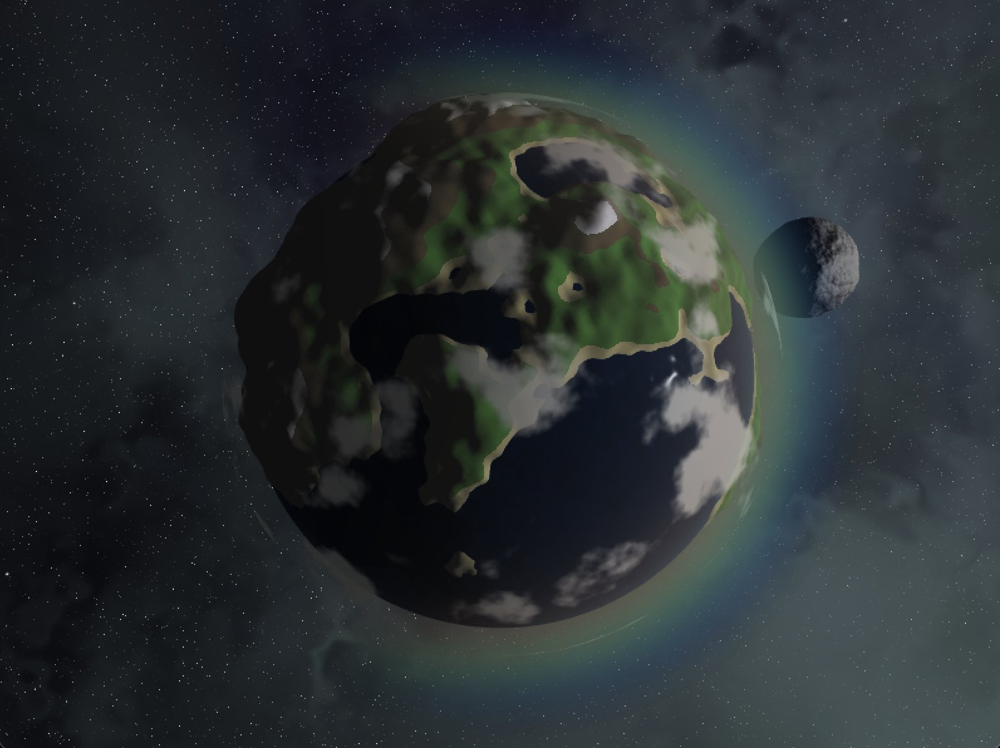

# Procedural Planet Viewer

A real-time procedural planet built in C++ and OpenGL, with layered oceans, clouds, and a ray-marched atmosphere, an orbiting moon, and a spacecraft you can fly under each body's gravity. Inspired by Outer Wilds and Kerbal Space Program.



Final project for JHU EN.605.767 Applied Computer Graphics (Spring 2026). More details on my [portfolio](https://bryancgarry.github.io/projects/planet-viewer.html).

## Features

- **Procedural terrain:** a subdivided icosphere displaced entirely in the vertex shader using noise.
- **Ocean:** a separate sea-level icosphere with perturbed normals for specular sparkle, plus Fresnel reflectance and depth-based coloring.
- **Clouds:** fBm noise sampled on a shell around the planet, offset over time by a speed and drift direction to suggest wind.
- **Atmosphere:** ray marching in a fragment shader.
- **Moon:** reuses the planet shader without terrain coloring and orbits the planet.
- **Spacecraft:** each body has a gravitational sphere of influence. The ship switches between first and third person and collides with each body using bounding spheres.

## My Code

Built on the course's scene graph framework. The files I wrote or changed:

| Area | Files |
|---|---|
| Scene setup and controls | `SampleProject/main.cpp` |
| Planet terrain | `SampleProject/planet.vert/.frag`, `SampleProject/planet_shader_node.hpp/.cpp`, `scene/icosphere.hpp/.cpp` |
| Ocean | `SampleProject/water.vert/.frag`, `SampleProject/water_shader_node.hpp/.cpp`, `scene/water_node.hpp/.cpp` |
| Clouds | `SampleProject/cloud.vert/.frag`, `SampleProject/cloud_shader_node.hpp/.cpp` |
| Atmosphere | `SampleProject/atmosphere.vert/.frag`, `SampleProject/atmosphere_shader_node.hpp/.cpp` |
| Spacecraft | `SampleProject/spacecraft.hpp/.cpp` |
| Framework changes | `scene/transform_node.hpp/.cpp`, `scene/camera_node.hpp/.cpp` |
| Skybox (from SpaceTime 3D) | `SampleProject/skybox*.hpp/.cpp`, `SampleProject/skybox_shader.vert/.frag` |

The full write-up I submitted is in [`ReadMe_FinalProject.txt`](ReadMe_FinalProject.txt).

## Building

The project uses the course framework's CMake build. Third-party libraries are **not** included in this repo: SDL3, Assimp, zlib, stb, and GLEW on Windows.

1. Put the prebuilt libraries in `lib/<platform>/` (for example `lib/macos/SDL3.framework`, `lib/macos/assimp`) and their headers in `include/` (`include/SDL3`, `include/assimp`, `include/stb`).
2. Generate and build:
   ```bash
   mkdir build && cd build
   cmake .. -G Xcode
   ```
3. Open the generated project and run the **SampleProject** target.

Developed and tested on macOS with Xcode.
